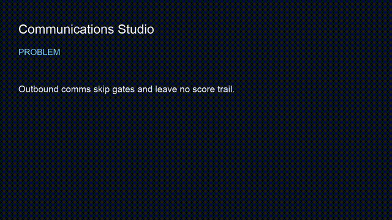

# communications-studio

> Gated communication protocol engine — scored formulas, hard gates, executable composition.
**Outcome:** `bash scripts/smoke.sh` runs pytest gates as the claim under test in a 60-second proof.


## Employer summary
Control plane for written communication quality: formulas, gates, tournaments. Not a spray-and-pray bot pack. Private prospect corpora stay offline.

## Proof in 60 seconds
```bash
git clone https://github.com/mrodgersjs-web/communications-studio.git
cd communications-studio
python3 -m pip install -e ".[test]"
bash scripts/smoke.sh
```

## Architecture
```text
draft → formula/scoring → gate engine → emit or reject
```

## Public boundary
See [docs/public-boundary.md](docs/public-boundary.md).

## Related
[fde-portfolio](https://github.com/mrodgersjs-web/fde-portfolio) · [doctrine](https://github.com/mrodgersjs-web/doctrine) · [proof-studio](https://github.com/mrodgersjs-web/proof-studio)


---


## Video walkthrough

- Script: [`docs/video-script.md`](docs/video-script.md)
- Recording: [`assets/demo.mp4`](assets/demo.mp4) (75s captioned)
- Preview: [`assets/demo.gif`](assets/demo.gif)



## FDE bar (this studio)

| Practice | Here |
| --- | --- |
| Employer summary | top of README |
| Smoke proof | `bash scripts/smoke.sh` |
| Public boundary | `docs/public-boundary.md` |
| Claim under test | pytest gates |
| Fleet | [profile](https://github.com/mrodgersjs-web) · [resume](https://github.com/mrodgersjs-web/resume) · [patents](https://github.com/mrodgersjs-web/patents) |

If `scripts/smoke.sh` fails, treat README claims as false until fixed.
