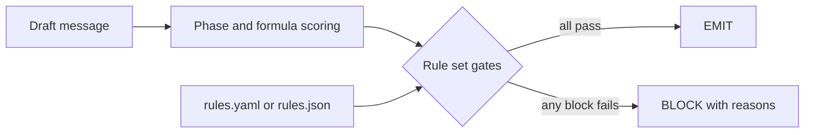

# communications-studio

[](https://github.com/mrodgersjs-web/communications-studio/actions/workflows/ci.yml)
[](LICENSE)
[](https://www.python.org/)

Checks AI-drafted messages against your writing rules and blocks the ones that fail. Built for anyone who sends outreach and wants a hard gate before anything goes out.

## Why this exists

AI writes outreach fast, and most of it reads like everyone else's. A wasted send costs attention you do not get back. This package scores every draft on specific, measurable signals (wound precision, specificity, reactance risk, banned phrases) and refuses to ship the ones that fail. The rules live in a YAML or JSON file you can change, so the gate matches your standards instead of a hardcoded list.

## Quickstart

```bash
python3 -m pip install -e .
python3 examples/run_example.py
```

## Usage

`examples/good_message.txt` is a real draft:

```text
Sarah,

Your team is spending 40% of engineering hours on architecture maintenance.
At 200 engineers, that is 80 full-time equivalents not shipping product. The
cost lands on every roadmap slip.
...
```

`python3 examples/run_example.py` scores it and a known-bad draft, and prints the block/emit decision. Real output from that command:

```json
=== good_message.txt ===
{
  "channel_formula": "email_voltage_score",
  "channel_score": 0.773,
  "comm_raw_score": 0.808,
  "decision": "EMIT",
  "blocks": [],
  "warnings": []
}
=== blocked_message.txt ===
{
  "channel_formula": "email_voltage_score",
  "channel_score": 0.685,
  "comm_raw_score": 0.594,
  "decision": "BLOCK",
  "blocks": [
    "AUTONOMY: AutonomyPreservation 0.35 < 0.70 - chasing detected",
    "BANNED_PHRASES: Banned phrases found: would love to chat, let me know your thoughts, hope this finds you well",
    "WOUND_GENERIC: WoundPrecision 0.35 < 0.60",
    "BELOW_DOCTRINE: CommRawScore 0.5940 < 0.65"
  ],
  "warnings": []
}
```

Check one file from the command line. Exit code 0 means emit, 2 means block:

```bash
rig gate examples/good_message.txt
```

```json
{
  "can_ship": true,
  "blocks": [],
  "warnings": []
}
```

Bring your own rules (see [docs/rules.md](docs/rules.md)):

```bash
rig rules-validate examples/rules.yaml
rig gate examples/blocked_message.txt --rules examples/rules.yaml
```

## How it works



Every gate reads its threshold, phrase list, and severity (block, warn, off) from one validated rule set. No rule set means the shipped doctrine defaults.

## What it proves

Checks a reader can run:

- `python3 examples/run_example.py` prints real scores and a block/emit decision for two drafts.
- `rig gate examples/blocked_message.txt` exits 2 and lists the gates that failed.
- `rig rules-validate examples/rules.yaml` prints `"valid": true`.
- `pytest -q` passes the whole suite, including tests that flip a decision by editing only the rule file.
- `ruff check .` is clean.

## Project layout

```text
rig_comm/            library: scoring, gate engine, rules, CLI
rig_comm/rules.py    rule set loading and validation (YAML / JSON)
rig_comm/gates.py    the gate engine, driven by the rule set
rig_comm/cli.py      `rig` command line entry point
examples/            runnable example messages and a rule file
tests/               pytest suite
docs/                architecture and rule set reference
```

## Development

```bash
python3 -m pip install -e '.[dev]'
pytest -q --cov=rig_comm
ruff check .
```

## Contributing

See [CONTRIBUTING.md](CONTRIBUTING.md).

## Security

See [SECURITY.md](SECURITY.md). Report issues to security@rodgersintelligence.com.

## License

MIT. See [LICENSE](LICENSE).

---

Built by Mike Rodgers · [rodgersintelligence.com](https://rodgersintelligence.com/)
